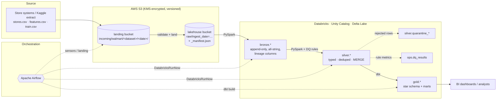

# Walmart Retail Sales Lakehouse — AWS S3 · Apache Airflow · Databricks/PySpark · dbt · SQL

An end-to-end, production-style data engineering pipeline that ingests, processes, transforms
and serves **Walmart weekly sales data** for analytics. Raw files arrive in **Amazon S3**,
**Apache Airflow** orchestrates every step, **PySpark on Databricks** builds Delta Lake
bronze/silver layers with automated data-quality gates, and **dbt** models the gold layer
(star schema + analytics marts) in SQL, with tests, snapshots and documentation.

The same code runs three ways, with configuration being the only difference:

| Mode | Storage | Spark | dbt | Use |
|---|---|---|---|---|
| `make pipeline` | local filesystem | local PySpark + Delta | DuckDB | laptop / CI, zero cloud cost |
| `docker compose up` | MinIO (S3 API) | local PySpark in Airflow | DuckDB | full Airflow orchestration locally |
| production | **AWS S3** (Terraform) | **Databricks** jobs (Asset Bundle) | **Databricks SQL** | real deployment |

---

## Architecture



### Airflow DAG `walmart_sales_pipeline` (weekly, Saturdays 06:00 UTC)

```
wait_for_source_files (S3KeySensor ×3, reschedule mode)
  └─► land_raw_files        validate headers/row counts, sha256 manifest, idempotent copy to raw/
        └─► bronze_ingest   Databricks job: 3 parallel tasks (stores/features/sales)
              └─► silver_transform   Databricks job: DQ rules → quarantine → dedupe → MERGE
                    └─► gold_dbt.source_freshness ─► gold_dbt.dbt_build  (seeds, SCD2 snapshot, models, tests)
                          └─► publish_run_summary   (SNS)        outlet: Dataset gold/fct_weekly_sales
```

Retries with exponential backoff, SNS alerting on any failure, `max_active_runs=1`, deferrable
Databricks operators (no worker slot held while Spark runs), and a manual-trigger parameter to
(re)process any batch date. A second DAG runs weekly Delta `OPTIMIZE … ZORDER` + `VACUUM`.

---

## What makes it production-grade

| Concern | How it is handled |
|---|---|
| **Idempotency** | Landing skips identical files by sha256 manifest; bronze writes with `replaceWhere` per `_ingest_date`; silver uses `MERGE`; gold fact is incremental `merge` on its grain. Re-running any day never duplicates data. |
| **Late / replayed data** | Silver MERGE only overwrites a row when the incoming version is at least as recent (`_ingested_at`), so backfilling an old batch can't clobber newer corrections. |
| **Data quality** | Declarative PySpark rules (`error` → quarantine table with failure reasons, `warn` → counted). Per-rule metrics in `ops.dq_results`. **Circuit breaker** fails the run if >5% of a batch is rejected. 64 dbt data tests + 3 dbt unit tests + reconciliation test (gold = silver). |
| **Schema drift** | Landing and bronze fail fast on missing required columns; additive columns are accepted (`mergeSchema`) and logged. |
| **History** | dbt snapshot gives SCD Type 2 store history (`dim_store_history`) — the demo's weekly batch includes a store remodel to show it. |
| **Lineage** | Every bronze/silver row carries `_ingest_date`, `_ingested_at`, `_source_file`, `_row_hash`; dbt docs give column-level docs and the model DAG; exposures declare the dashboard. |
| **Security** | SSE-KMS with key rotation, TLS-only bucket policies, public access blocked, least-privilege IAM for Airflow, Unity Catalog storage credential role, tokens in Secrets Manager. |
| **Cost** | Graviton job clusters, autoscaling 1–4 workers, spot-with-fallback, lifecycle tiering of raw files to Glacier IR, noncurrent-version expiry. |
| **CI** | GitHub Actions: ruff, pytest (incl. Spark integration tests), full pipeline + `dbt build` on DuckDB, Airflow DagBag integrity, `terraform validate`. |

---

## Data

Schema and quirks exactly match the Kaggle
[Walmart Recruiting – Store Sales Forecasting](https://www.kaggle.com/competitions/walmart-recruiting-store-sales-forecasting/data)
dataset (45 stores, ~80 departments, 143 weeks, ~420k sales rows):

| File | Columns |
|---|---|
| `stores.csv` | Store, Type (A/B/C), Size (sq ft) |
| `features.csv` | Store, Date, Temperature, Fuel_Price, MarkDown1–5, CPI, Unemployment, IsHoliday |
| `train.csv` | Store, Dept, Date, Weekly_Sales, IsHoliday |

A deterministic generator (`walmart-generate`) produces realistic data with the same schema —
store formats and sizes, department mix, seasonality, Thanksgiving/pre-Christmas peaks, markdown
lift, macro effects, return weeks, `NA` markdowns before Nov 2011 and missing CPI values — plus a
small share of injected defects (duplicates, impossible dates, non-numeric sales, missing keys)
so the quality layer has something to catch. To use the real data instead:

```bash
kaggle competitions download -c walmart-recruiting-store-sales-forecasting && unzip -o '*.zip' -d data/kaggle
make batch SRC=data/kaggle BATCH=2012-10-27
```

## Gold layer (dbt)

```
staging (views)                 intermediate                 marts (tables, schema gold)
stg_walmart__stores ─┬─► stores_snapshot (SCD2) ─► dim_store, dim_store_history
stg_walmart__weekly_sales ──────────────────────────► fct_weekly_sales (incremental, grain store×dept×week)
stg_walmart__store_features ─► int_store_features_filled ─┘        │
seeds: department_names, holiday_weeks ─► dim_department, dim_date (Walmart fiscal year ends 31 Jan)
                                                                    ▼
             mart_store_weekly_performance · mart_holiday_impact · mart_markdown_effectiveness
             mart_department_performance · mart_monthly_kpis
```

| Mart | Answers |
|---|---|
| `mart_store_weekly_performance` | Store sales, sales/sq ft, WoW and YoY growth, 4-week trend, weekly rank |
| `mart_holiday_impact` | Lift of Super Bowl / Labor Day / Thanksgiving / Christmas weeks vs. each store's baseline, by format |
| `mart_markdown_effectiveness` | Sales lift and incremental sales per markdown dollar by spend band |
| `mart_department_performance` | Department revenue, share of chain, rank, YoY run-rate growth per fiscal year |
| `mart_monthly_kpis` | Executive scorecard: monthly sales, holiday share, YoY run-rate growth |

Models are cross-database: small dispatch macros (`day_of_week_iso`, `last_value_ignore_nulls`,
incremental strategy) let the identical SQL run on DuckDB locally and Databricks in production.

---

## Quick start (local, no cloud account)

Requirements: Python 3.10–3.12, Java 11 or 17 (for Spark), [uv](https://docs.astral.sh/uv/).

```bash
make setup      # .venv with PySpark, Delta, dbt-duckdb, test tooling; dbt deps
make pipeline   # history backfill (2010-02 → 2012-10-19), then one incremental week
make test       # unit + Spark integration tests
make dbt-docs   # browse model docs and lineage at http://localhost:8081
```

`make pipeline` runs: generate → publish to drop zone → land/validate → bronze → silver → dbt
source freshness → dbt build. Query the results:

```bash
.venv/bin/python -c "import duckdb; print(duckdb.connect('data/warehouse/walmart.duckdb').sql('select * from gold.mart_holiday_impact order by holiday_lift_pct desc'))"
```

## Run it with Airflow (docker-compose + MinIO)

```bash
make up                 # Postgres, MinIO, Airflow webserver/scheduler/triggerer
make seed-minio         # drop a batch into s3://walmart-retail-landing/incoming/... on MinIO
```

Open http://localhost:8080 (admin / admin), unpause `walmart_sales_pipeline` and trigger it with
config `{"ingest_date": "2012-10-20"}`. MinIO console: http://localhost:9001.

## Deploy to AWS + Databricks

1. **Infrastructure** – `cd infra/terraform`, copy `terraform.tfvars.example` → `terraform.tfvars`,
   `terraform init -backend-config=...` and `terraform apply`. Creates KMS-encrypted landing and
   lakehouse buckets with lifecycle rules, SNS alert topic, Secrets Manager secret, IAM policy for
   Airflow, the Unity Catalog storage-credential role, external location, catalog and schemas.
2. **Spark jobs** – `databricks bundle deploy -t prod` builds the `retail_pipeline` wheel and
   deploys `walmart-bronze-ingest`, `walmart-silver-transform`, `walmart-lakehouse-maintenance`.
3. **Airflow** (MWAA, Astronomer or self-hosted) – attach the Terraform IAM policy, install
   `apache-airflow-providers-{amazon,databricks}`, `retail-pipeline` and dbt; set
   `PIPELINE_COMPUTE=databricks`, `DBT_TARGET=databricks` and the variables in `.env.example`.

---

## Repository layout

```
├── src/retail_pipeline/
│   ├── generator/walmart.py       # deterministic Walmart-schema data generator
│   ├── ingestion/landing.py       # drop zone → raw zone: validation, manifests, idempotency
│   ├── ingestion/storage.py       # S3 / MinIO / local storage abstraction
│   ├── spark/bronze.py            # raw CSV → bronze Delta (lineage, schema-drift checks)
│   ├── spark/silver.py            # typing, DQ rules, quarantine, dedupe, MERGE, circuit breaker
│   ├── spark/quality.py           # declarative PySpark data-quality rule engine
│   ├── spark/lakehouse.py         # Delta I/O by Unity Catalog name or path
│   └── jobs/run_layer.py          # single CLI entrypoint (Databricks wheel task / Airflow / local)
├── airflow/dags/                  # weekly pipeline DAG, maintenance DAG, SNS alerting
├── dbt/                           # staging → intermediate → marts, snapshot, seeds, tests, macros
├── databricks.yml + databricks/   # Databricks Asset Bundle (jobs, clusters)
├── infra/terraform/               # S3, KMS, IAM, SNS, Secrets Manager, Unity Catalog
├── tests/                         # pytest: generator, landing (moto S3), Spark layers, DAG integrity
├── docker-compose.yml             # MinIO + Airflow local stack
├── .github/workflows/ci.yml
└── docs/                          # architecture decisions, data dictionary, runbook
```

See [`docs/architecture.md`](docs/architecture.md), [`docs/data_dictionary.md`](docs/data_dictionary.md)
and [`docs/runbook.md`](docs/runbook.md).

## License

[MIT](LICENSE)
